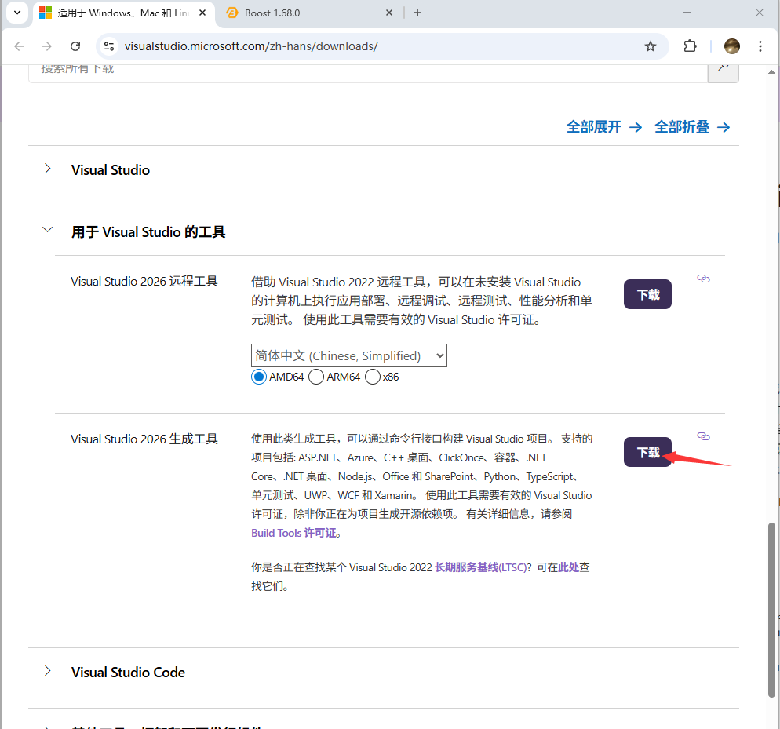
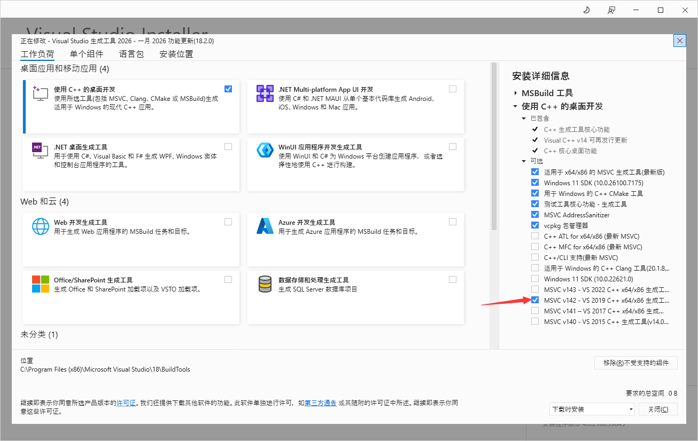
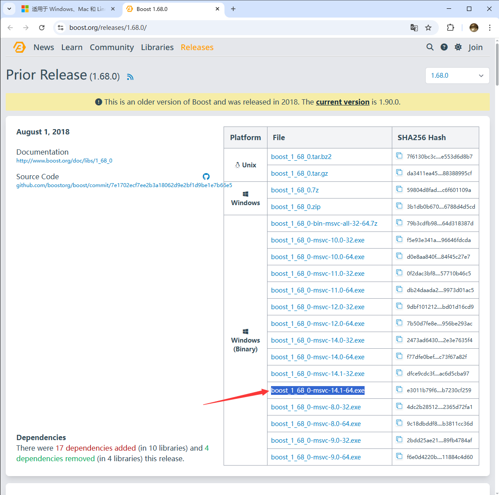
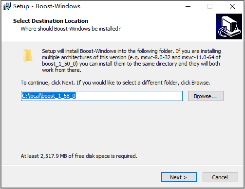
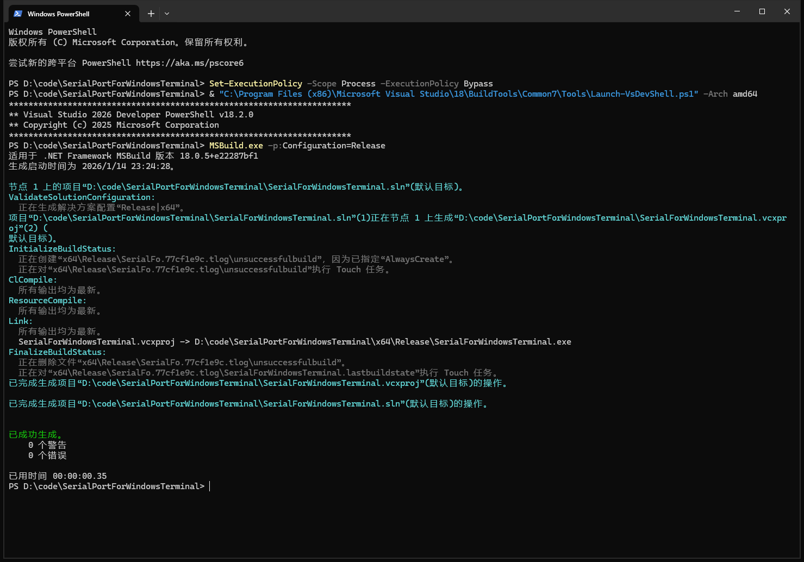

# SerialPortForWindowsTerminal
Serial port for windows terminal, 让Windows Terminal支持串口的插件

该插件为WindowsTerminal提供访问串口终端能力


## 使用说明


## 配置说明：


## 编译说明

### 下载`MSBuild`

打开<https://visualstudio.microsoft.com/zh-hans/downloads/>，选择`Visual Studio 2026 生成工具`，点击下载



安装选择`MSVC v142`



### 下载`Boost 1.68.0`

打开<https://www.boost.org/releases/1.68.0/>，下载`boost_1_68_0-msvc-14.1-64.exe`



安装到`C:\local\boost_1_68_0`



### 编译

在代码目录打开一个powershell终端，执行如下命令



```shell
PS D:\code\SerialPortForWindowsTerminal> Set-ExecutionPolicy -Scope Process -ExecutionPolicy Bypass
PS D:\code\SerialPortForWindowsTerminal> & "C:\Program Files (x86)\Microsoft Visual Studio\18\BuildTools\Common7\Tools\Launch-VsDevShell.ps1" -Arch amd64
PS D:\code\SerialPortForWindowsTerminal> MSBuild.exe -p:Configuration=Release
PS D:\code\SerialPortForWindowsTerminal>
```

其中

- `Set-ExecutionPolicy -Scope Process -ExecutionPolicy Bypass`是临时改变PowerShell执行策略
  - <https://learn.microsoft.com/zh-cn/powershell/module/microsoft.powershell.core/about/about_execution_policies>
- `& "C:\Program Files (x86)\Microsoft Visual Studio\18\BuildTools\Common7\Tools\Launch-VsDevShell.ps1" -Arch amd64`是加载MSBuild编译环境
- `MSBuild.exe -p:Configuration=Release`编译Release目标
  - 生成的文件在`D:\code\SerialPortForWindowsTerminal\x64\Release\SerialForWindowsTerminal.exe`
